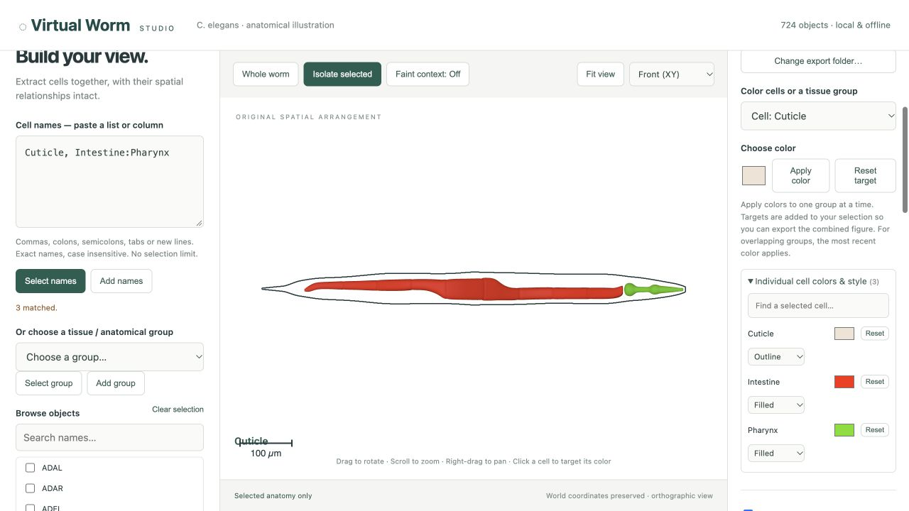

# Virtual-Worm-Studio

An offline graphical tool for making **C. elegans anatomical illustrations** for talks, articles, posters, and presentations. Select cells and tissues by name, keep their original spatial arrangement, change their colors, mix filled organs with hollow tissue outlines, add a calibrated scale bar, and export your figure.

**Prepared anatomy is included. Downloading the original `.blend` file is optional.** You can use the viewer and export PNG, GLB, CSV, and saved views without installing Blender or downloading another model.

This is a very useful tool for those who are not familiar with blender {https://www.blender.org} tools but want to use beautiful worm illustration/s for presentation, talk, article, book chapter or social media post. Examples: 
 

The anatomy was imported from **Chris Grove's Virtual Worm model, WormBase / California Institute of Technology**. See [Anatomy source and citation](#anatomy-source-and-citation). This is an independent illustration interface, not an official WormBase or Caltech application.



Version **1.5.0** includes the nested-tissue visibility fixes from the local Mac app, plus portable launchers and optional Blender configuration.


## Start here after downloading

Extract the full ZIP and open its **virtual-worm-studio** subfolder.
The repository's outer folder contains this README and example figures;
the actual app and launchers are in the subfolder.

- **Windows:** install Python 3.10+, then double-click
  [virtual-worm-studio/Start-Windows.cmd](virtual-worm-studio/Start-Windows.cmd).
  Windows may display the filename as `Start-Windows` if extensions are hidden.
- **Mac:** run `python3 virtual-worm-studio/launch.py` from the repository root,
  or open `virtual-worm-studio/Start-Mac.command`.
- **Linux:** run `python3 virtual-worm-studio/launch.py` from the repository root.

A source download does **not** include `VirtualWormStudio.exe`. The build
workflow creates standalone archives containing the executable and its support
files. Run it through the repository's **Actions** tab, download the Windows
artifact, and extract both ZIP layers before launching the executable.
Published Releases, when available, are the easiest end-user download.
Python is not required in a standalone build. Prepared anatomy is included in
both source and standalone distributions; Blender remains optional.

From PowerShell in the repository root, the direct source command is:

```powershell
py -3 virtual-worm-studio/launch.py
```

## Contents

- [What is included](#what-is-included)
- [Requirements](#requirements)
- [Install and run locally](#install-and-run-locally)
- [Optional original model and Blender](#optional-original-model-and-blender)
- [Create your first illustration](#create-your-first-illustration)
- [Colors and line art](#colors-and-line-art)
- [Scale bar](#scale-bar)
- [Export formats and filenames](#export-formats-and-filenames)
- [Save and reopen a view](#save-and-reopen-a-view)
- [Folders, offline operation, and updates](#folders-offline-operation-and-updates)
- [Troubleshooting](#troubleshooting)
- [GitHub publishing and standalone builds](#github-publishing-and-standalone-builds)
- [Anatomy source and citation](#anatomy-source-and-citation)

## What is included

- Prepared February 2012 Virtual Worm anatomy: **724 selectable objects**, including stored alternate source objects marked `[stored]` in the browser.
- Local Three.js r170 renderer and export libraries; no CDN, account, cloud API, npm installation, or runtime pip dependencies.
- macOS, Windows, and Linux launchers, Python server, and all viewer source.
- Name-list and tissue-group selection, individual cell colors and Filled/Outline styles, and an on/off faint-context switch.
- PNG figures up to 6000 pixels wide, GLB 3D geometry, CSV cell lists, and reloadable JSON/PNG views.
- Optional editable `.blend` extraction through a separately installed compatible Blender and the original model.
- Asset checksums, automated tests, and a GitHub Actions workflow that can build native portable downloads.

The prepared anatomy is compressed into two small repository files. Startup verifies and expands them into `cache/model.bin`. Keep **both** `assets/model.bin.gz.part*` files and the manifest. They are parts of one archive; do not extract them individually.

## Requirements

| Component | Required for |
| --- | --- |
| macOS, Windows, or desktop Linux with a graphical session | Running the viewer |
| Python **3.10 or newer** | Running the source package; 3.11/3.12 are the CI targets |
| A browser with JavaScript, ES modules/import maps, WebGL2, and hardware acceleration | The graphical interface |
| A writable extracted app folder | Settings, geometry cache, and default exports |
| Compatible Blender plus original February 2012 `.blend` | **Only** editable `.blend` exports |
| Internet access | Initial downloads and optional update/build dependencies; not normal use |

Allow about **150 MB free disk space** for the source package, expanded geometry cache, and initial figures. Blender and large exports need additional space. Several GB of RAM are advisable for high-resolution figures and large selections. Performance depends on the GPU and number of outlined structures.

Python is available from [python.org](https://www.python.org/downloads/). No Python packages need to be installed to run the source application.

**Testing status:** the source launcher, viewer, export routes, nested outlines, and Blender 3.0.1 extraction have been exercised locally on macOS Apple Silicon. Windows/Linux launchers and build configuration are supplied, with CI jobs for all three operating systems; those jobs must run in your GitHub repository before claiming native Windows/Linux verification. Each standalone executable targets the OS and CPU architecture on which it is built. Linux builds use the host's system-library baseline.

## Install and run locally

### 1. Get and extract the package

Download the source ZIP (or use GitHub **Code → Download ZIP** after this repository is published). **Extract all files** into a writable folder such as `Documents/VirtualWormStudio`. Do not run from inside the ZIP, a read-only disk image, or a protected system directory.

Alternatively, clone the repository using its actual URL:

```sh
git clone https://github.com/aksharmaleiferlab/Virtual-Worm-Studio.git
cd Virtual-Worm-Studio/virtual-worm-studio
```

The commands below assume you are in the nested `virtual-worm-studio` folder containing `launch.py`.

### 2a. macOS

1. Install Python 3.10+ from python.org if necessary.
2. Open Terminal in the extracted folder.
3. Run:

```sh
python3 --version
python3 launch.py
```

You can also double-click **Start-Mac.command**. If executable permissions were lost during download, run:

```sh
chmod +x Start-Mac.command
./Start-Mac.command
```

The source launcher opens your default browser. Keep its Terminal window open. This portable package does not replace an existing native Mac `.app` installation.

### 2b. Windows

1. Install Python 3.10+ from python.org. Enable the Python launcher / PATH option offered by the installer.
2. Extract the entire ZIP into a folder you can write to.
3. Double-click **Start-Windows.cmd**.

Or open PowerShell / Command Prompt in that folder and run:

```powershell
py -3 --version
py -3 launch.py
```

If `py` is unavailable but `python` points to Python 3.10+, use:

```powershell
python launch.py
```

An execution alias that only opens the Microsoft Store is not an installed Python interpreter. Install Python and retry. Keep the command window open while using the app.

### 2c. Linux

Install Python 3.10+ using your distribution's package manager. For example, on a suitable Ubuntu/Debian release:

```sh
sudo apt update
sudo apt install python3
python3 --version
python3 launch.py
```

Other distributions use their own package manager. You can also run:

```sh
chmod +x start-linux.sh
./start-linux.sh
```

A graphical browser and working GPU drivers are required. In a remote/headless terminal, use `--no-browser` and open the printed local URL on the same graphical computer; the server intentionally listens only on localhost.

### 3. Open the viewer and quit cleanly

The launcher opens a URL such as `http://127.0.0.1:54321`. The port is normally chosen automatically. If the browser does not open, copy the exact printed URL into a browser **on the same computer**. Do not open `web/index.html` directly.

To stop, return to the launcher's Terminal/command window and press **Ctrl+C**. Closing only the browser tab does not stop the local server. Save a view before quitting if you want to preserve your figure setup.

Useful options:

```sh
python3 launch.py --no-browser
python3 launch.py --port 8765
python3 launch.py --data-dir "/absolute/path/to/My Worm Figures"
python3 launch.py --doctor
```

On Windows replace `python3` with `py -3`, and use an absolute Windows path such as `C:\Users\YOUR_NAME\Documents\My Worm Figures`. `--doctor` verifies anatomy assets and reports optional Blender/model paths; missing optional components do not prevent normal viewing.

### Using a future standalone download

The build workflow produces a **portable folder archive**, not a one-file installer:

1. Download the archive for your OS and CPU from the repository's published Releases (once a maintainer uploads a built archive).
2. Extract the **entire** archive into a writable folder.
3. Run `VirtualWormStudio.exe` on Windows, or `./VirtualWormStudio` on macOS/Linux.
4. Keep its console open and use the browser window it opens. Stop with Ctrl+C.

Python is bundled in those builds. Blender remains optional and external. Keep `_internal` and every accompanying file next to the executable. These builds are not signed/notarized installers; organization or OS policy may require a maintainer-signed build. The source ZIP itself does not contain prebuilt Windows/Linux executables.

## Optional original model and Blender

**Skip this entire section unless you want editable `.blend` exports.** PNG, GLB, CSV, saved views, and the prepared viewer are already available.

### Download and save the original model

1. Visit the [Virtual Worm Project](https://caltech.wormbase.org/virtualworm/).
2. Follow **Download Virtual Worm .blend File**. The original site's linked [model directory](http://canopus.caltech.edu/virtualworm/Virtual%20Worm%20Blend%20File/) is also documented here for convenience.
3. Choose **Virtual_Worm_February_2012.blend**. Do not substitute the January, March, or June versions: the included catalog and geometry are from February 2012.
4. Save the actual file locally, preferably as `model/Virtual_Worm_February_2012.blend` beside this README. Restart the app after copying it there.
5. If you keep it elsewhere, enter its full absolute path under **Model & Blender setup** in the right panel and click **Save local model setup**.

The [original instructional videos](https://caltech.wormbase.org/virtualworm/Instructional_Videos.html) describe the source Blender model. Some project download links are legacy links and may be temporarily unavailable; use the project homepage to find the current download location.

Reference SHA-256 of the original used to prepare this release:

```text
510e9234b65c3890896bf7c0f8b734b219070a97dc68b248596d6f8c8ceb8fea
```

This reference is for reproducibility; the app does not enforce it. A resaved/modified file may differ. Use the unmodified original to match the prepared anatomy. Loading another `.blend` as the export source does **not** update the viewer's prepared geometry or catalog.

### Install and configure compatible Blender

The legacy model was tested using **Blender 3.0.1**. Obtain the correct OS/architecture from Blender's [official previous versions page](https://www.blender.org/download/previous-versions/) or [3.0 release directory](https://download.blender.org/release/Blender3.0/). The source file was originally made with Blender 2.49; the provided extraction script uses the newer Blender Python API. Blender 2.49 itself cannot run this script.

New Blender releases have not been validated for this legacy file; Blender 4.5 encountered a startup failure on the development Mac. Blender 3.0.1 is old and may not run on every modern OS/GPU. Check Blender's requirements for your computer. If it cannot run, continue using the prepared viewer and GLB exports while testing an appropriate compatible Blender separately.

Open **Model & Blender setup** and enter the full executable path. Examples:

| OS | Example path |
| --- | --- |
| macOS | `/Applications/Blender.app` or `/Applications/Blender.app/Contents/MacOS/Blender` |
| Windows | `C:\Program Files\Blender Foundation\Blender 3.0\blender.exe` |
| Linux | `/home/YOUR_NAME/Applications/blender-3.0.1-linux-x64/blender` |

Do not include surrounding quote characters in the GUI fields. Click **Save local model setup** and check that both components are found. Automatic discovery checks `blender` on PATH, the usual macOS application path, and common Windows installation directories. If several versions are installed, explicitly choose the tested one.

You can configure paths from the terminal instead:

```sh
python3 launch.py --model "/absolute/path/Virtual_Worm_February_2012.blend" --blender "/absolute/path/to/blender"
```

On Windows, for example:

```powershell
py -3 launch.py --model "C:\Users\YOUR_NAME\Documents\VirtualWormStudio\model\Virtual_Worm_February_2012.blend" --blender "C:\Program Files\Blender Foundation\Blender 3.0\blender.exe"
```

The settings persist locally. `VWS_MODEL` and `VWS_BLENDER` environment variables are also supported; saved nonempty paths take precedence. Blank setup fields return to discovery/environment defaults.

## Create your first illustration

1. Paste `Cuticle, Intestine, Pharynx` into **Cell names**.
2. Click **Select names**. All three remain at their original relative positions.
3. Expand **Individual cell colors & style** in the right panel.
4. Set **Cuticle → Outline**, **Intestine → Filled**, **Pharynx → Filled**.
5. Choose a color swatch for each organ. For example, use red for intestine and green for pharynx.
6. Drag to rotate, scroll to zoom, and right-drag to pan. Use **Fit view** if necessary.
7. Enable a scale bar if wanted. Choose white or transparent background and the image shape.
8. Enter a filename such as `Figure-2-digestive-system`, then click **Save PNG image**.
9. Check the saved path shown in the right panel. By default it is in the extracted app folder.
10. Use **Save view / selection** to save an editable JSON setup as well.

### Select named cells or groups

Paste a column from a spreadsheet, or separate exact names using commas, colons, semicolons, spaces, tabs, or line breaks:

```text
ALA
ALML, ALMR
AVAL: AVAR
```

Names are case insensitive. Use **Browse objects** to find exact names. There is no fixed selection-count cap; available memory and rendering performance are the practical limits.

- **Select names** replaces the current selection. **Add names** extends it.
- **Select group** replaces the selection with a tissue group. **Add group** preserves existing selected items.
- Checkboxes explicitly add/remove objects. **Clear selection** clears the selection.
- A click on a 3D structure adds/targets it for coloring; it does not toggle its visibility off. If you click an enclosing cuticle, the cuticle can be the object targeted rather than an organ behind it. Use named controls for precise editing.
- Items marked `[stored]` were stored outside the original active scene. They may duplicate other representations. Select them intentionally for your figure.

### Views and context

- **Whole worm** shows the original active-scene anatomy plus selected stored objects.
- **Isolate selected** shows only selected structures.
- **Faint context: On/Off** toggles transparent anatomical context and returns to the previous view when switched off.
- Front (XY), Side (XZ), and Top (YZ) use an orthographic camera. Perspective size distortion is avoided.

## Colors and line art

The color target can be the current selection, names in the left column, a tissue group, or a cell targeted in the viewport. Click **Apply color** after choosing a group color. Coloring a target also adds it to the selection. When targets overlap, the most recent color applies.

For exact control, expand **Individual cell colors & style** and use each item's color, Reset button, and **Filled/Outline** menu. Reset changes that item's color; it does not remove it from the selection.

**Outline selected** assigns line art to all currently selected items; **Fill selected** restores those items to filled surfaces. The master checkbox switches assigned outlines on/off without forgetting their assignments. On first enabling with no assignments, it assigns the current selection.

Each outlined object now retains **its own outer silhouette**, including pharynx/intestine inside an outlined cuticle. Mesh triangle edges are omitted. To retain organ colors, leave those organs **Filled**. Line color and width are shared by outlined structures. Filled foreground tissues can hide outline segments behind them; faint context does not hide them. The cuticle's hollow interior does not hide filled organs.

Assignments persist when selections change and are stored in saved views. If an older saved view assigned all three tissues to outlines, choose Filled for the organs after loading it. Outlining many cells separately takes more rendering time than outlining one shell.

Line art is included in the preview and PNG only. GLB and Blender exports remain editable 3D surfaces; labels and scale bars are also 2D figure overlays.

## Scale bar

Enable **Show scale bar**, enter its length, and choose **nm, µm, mm, or Model units**. Changing units converts the numeric length to preserve physical size. Choose the corner and automatic/dark/white contrast. The bar responds to zoom and is included in PNG exports.

Default calibration comes from the source model's named `100um` reference: approximately **100.0034333454 µm per model unit**. Expand **Scale calibration** to override it. Check that the bar length fits your current view; the status text explains invalid or oversized settings. Calibration is a model reference, not a claim that every anatomical dimension represents every individual worm or developmental stage.

## Export formats and filenames

Enter an export filename without an extension. The app adds the appropriate extension. Avoid reserved Windows names such as `CON`, and characters `< > : " / \ | ? *`. Existing files are preserved: duplicates receive `_1`, `_2`, etc.

| Button | Output | Includes |
| --- | --- | --- |
| Save PNG image | `.png` | Visible view, filled colors, outlines, visible context, optional labels and scale bar; embedded reloadable view settings |
| Save selected 3D .glb | `.glb` | Selected evaluated surfaces with colors and original relative spatial arrangement |
| Save selected .blend | `.blend` | Selected editable source objects with colors; requires optional Blender/model setup |
| Save cell list .csv | `.csv` | Selected names, groups, and hexadecimal colors |
| Save view / selection | `-view.json` | Selection, colors, line-art assignments, camera, background, labels, scale, and figure options |

PNG width options are 2400, 3840, and 6000 pixels. Shapes include 16:9, 4:3, square, and current viewport. Transparent PNG works well on slides. Physical print size/DPI can be set in your publishing software; the export controls pixel dimensions.

The default export directory is the app's data folder, initially the extracted source/executable folder. **Change export folder…** opens an absolute-path field in the browser version. Paste a writable folder path and click **Use this folder**. The folder is created if needed, and the choice persists in `settings.json`. No native folder-picker dialog is required.

3D exports contain only selected objects, not faint context. No cells are individually recentered or rescaled. GLB importers may convert axis/unit conventions; use `.blend` when retaining original Blender numeric world coordinates matters. PNG line art and scale bars are not baked into 3D files.

## Save and reopen a view

Use **Load saved view / PNG** and select a saved-view JSON or a PNG produced by a version that embeds view settings. The app restores your selection, colors, camera, Filled/Outline assignments, and figure options.

A random PNG, screenshot, or older export without embedded settings cannot reconstruct a 3D scene. Load its companion saved-view JSON instead. Image editors or publishing software may strip metadata; keep your JSON backup. Loading a view is not a way to import arbitrary anatomy models or external Blender files.

Settings for paths/export directory persist automatically. The current figure does **not** autosave; save a JSON/PNG before quitting.

## Folders, offline operation, and updates

```text
virtual-worm-studio/
  launch.py, runtime.py, server.py    Portable launcher and local API
  Start-Mac.command                 macOS convenience launcher
  Start-Windows.cmd                 Windows convenience launcher
  start-linux.sh                    Linux convenience launcher
  web/                              Offline graphical interface and vendor libraries
  assets/                           Compressed prepared anatomy and checksums
  model/README.md                   Instructions for the OPTIONAL original .blend
  export_blend.py                    Optional Blender extraction script
  prepare_model.py                   Developer-only anatomy preprocessing
  scripts/build.py                  Build standalone folder archives
  tests/                            Backend/export/metadata tests
  .github/workflows/build.yml        Three-OS CI and builds
  docs/                             Screenshots and maintainer instructions
  settings.json                     Created locally; ignored by Git
  cache/model.bin                   Created locally; ignored by Git
```

The server binds to **127.0.0.1** and uses a per-run token for write requests. Rendering and saving happen on your machine. No login, upload, analytics, or network model fetch is required. Project/download links open external sites only when clicked. This local tool is not intended as a shared public web service.

Close the app before updating. Save your figures and JSON files, keep the original model if downloaded, and extract a new release into a new folder. Copy only your settings/model/exports as needed. A saved absolute export path remains active after moving settings. `cache/` can be rebuilt automatically. Do not publish settings, user figures, or logs in the Git repository.

## Troubleshooting

| Symptom | What to do |
| --- | --- |
| Python not found | Install Python 3.10+; try `python3` on Mac/Linux or `py -3` on Windows. |
| Browser does not open | Open the exact URL printed by the launcher. Leave its terminal running. |
| Blank viewer or shader error | Enable browser hardware acceleration; try a browser with WebGL2; update GPU drivers. Do not open the HTML using `file://`. |
| Address already in use | Omit `--port` to choose an available port, or choose a different port. |
| Permission denied / cannot create cache | Extract to a writable Documents folder or pass `--data-dir` with a writable absolute folder. |
| Missing/damaged anatomy | Keep both compressed parts and manifest. Extract the complete package again; `--doctor` checks them. |
| Pharynx/intestine missing after outlining cuticle | Use Individual cell colors & style: Cuticle=Outline, organs=Filled. If all three are Outline, each should still have a visible boundary in this version. Also confirm all names remain selected and use Add names/group when extending a selection. |
| Wrong cell receives color after a viewport click | An enclosing surface can be hit first. Use its named row or the name-list color target. |
| PNG will not load as a saved view | It may lack embedded data or have had metadata stripped. Load the saved-view JSON. |
| `.blend` export unavailable | This is optional. Configure both original model and compatible Blender; other formats still work. |
| `.blend` extraction fails | Check paths and permissions, use the original February 2012 file, test Blender 3.0.1, and inspect `last-error.log` in the data folder. Extractions time out after 180 seconds. |
| Export folder does not change | Use an absolute writable path, then Use this folder. Read the status/error text. |
| Large PNG/outline export is slow | Try 2400 px, reduce outlined cells or context, and allow the operation to finish. |

## GitHub publishing and standalone builds

See [docs/MAINTAINERS.md](virtual-worm-studio/docs/MAINTAINERS.md) for exact repository-upload, CI, build, testing, release, and anatomy-regeneration instructions.

To run backend checks from the repository root:

```sh
python3 -m unittest discover -s tests -v
python3 launch.py --doctor
```

Optional JavaScript tests require Node.js 20+ for development only:

```sh
node --test tests/web.test.mjs
```

To build a standalone download on the current OS:

```sh
python3 -m venv .venv
# Mac/Linux activation:
. .venv/bin/activate
# Windows PowerShell activation, instead:
# .venv\Scripts\Activate.ps1
python -m pip install -r requirements-build.txt
python scripts/build.py
```

Builds appear in `release/`. Build separately on each OS and CPU architecture; PyInstaller is not a cross-compiler. The included workflow tests on macOS, Windows, and Linux, then builds downloadable artifacts when manually triggered or when a version tag is pushed. It does not automatically publish a public GitHub Release. No code is uploaded by running the local application.

## Anatomy source and citation

The anatomy was imported from the **February 2012 Virtual Worm model**, built by **Chris Grove, PhD**, for **WormBase** at the **California Institute of Technology**. The original project states that its model is available under the MIT license with appropriate attribution.

- [Virtual Worm Project / model source](https://caltech.wormbase.org/virtualworm/)
- [Original instructional videos](https://caltech.wormbase.org/virtualworm/Instructional_Videos.html)
- [WormBase](https://wormbase.org/)

Suggested figure credit (adapt to your publication's style):

> Anatomy imported from the Virtual Worm Project, February 2012 model, Chris Grove / WormBase / California Institute of Technology. Figure prepared with Virtual Worm Studio.

This is a suggested attribution, not a fabricated journal reference or DOI. Preserve model attribution when sharing figures or derived geometry. Include any additional credits required by your venue.

Application code: [MIT license](virtual-worm-studio/LICENSE). Vendored Three.js: MIT, original notice in [web/vendor/THREE-LICENSE.txt](virtual-worm-studio/web/vendor/THREE-LICENSE.txt). Prepared anatomy source and third-party details: [THIRD_PARTY_NOTICES.md](virtual-worm-studio/THIRD_PARTY_NOTICES.md). Blender is separately downloaded software under its own GPL terms and is not bundled in this repository or its build workflow.
